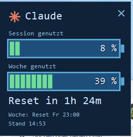
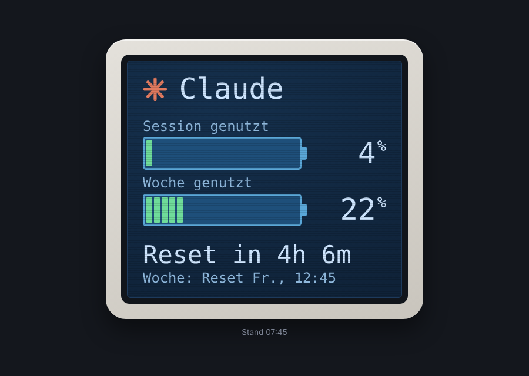

# claude_usage – Claude Usage Monitor

Zeigt die Auslastung eines Claude-Abos (Pro/Max) im Stil eines kleinen Displays:
Session (5 Std.) und Woche als Akku-Balken, dazu der Reset-Countdown.
Als Webseite im Browser und als Windows-Tray-Anwendung mit Desktop-Fenster.

<p>
  
  &nbsp;
  
</p>

*Links: Desktop-Fenster der Tray-Anwendung · Rechts: Webansicht*

> **Hinweis:** Nutzt den inoffiziellen Endpoint `api.anthropic.com/api/oauth/usage`,
> den auch Claude Code für `/usage` verwendet. Kann sich ohne Ankündigung ändern.
> Funktioniert nur mit Pro/Max-Abos, nicht mit Team/Enterprise.

## Aufbau

```
Server (eine Variante wählen)            Anzeige
┌──────────────────────────────┐        ┌───────────────────────┐
│ docker/  Docker-Container    │──JSON──│ Webseite (Browser)    │
│ php/     PHP-Webspace        │        │ tray/ Windows-Tray    │
└──────────────────────────────┘        └───────────────────────┘
```

| Ordner | Wofür | Anleitung |
|---|---|---|
| `docker/` | Homeserver / NAS mit Docker (ZimaOS, Synology, …) | [docker/README.md](docker/README.md) |
| `php/` | Webspace mit PHP ≥ 7.4 + cURL, ohne Docker (z. B. all-inkl) | [php/README.md](php/README.md) |
| `tray/` | Windows-Infobereich + Display-Fenster (PowerShell, keine Installation) | [tray/README.txt](tray/README.txt) |

## Schnellstart

```sh
git clone https://github.com/sembusoft/claude_usage.git
```

1. Server-Variante einrichten (Docker **oder** PHP).
2. Einmalig bei Claude anmelden – jeder nutzt **sein eigenes** Abo/Login.
3. Webseite öffnen bzw. in `tray/ClaudeUsageTray.ps1` oben `$Url` (und ggf. `$ApiPath`) eintragen.

## Sicherheit

- Die Login-Datei (`.credentials.json` / `credentials.json`) enthält dein Zugangstoken.
  Sie ist per `.gitignore` ausgeschlossen – **niemals committen oder weitergeben**.
- Ein Login nur an **einer** Stelle betreiben: Beim Erneuern wird das Token getauscht,
  zwei Instanzen mit derselben Datei sperren sich gegenseitig aus.
- Öffentlich erreichbare PHP-Installationen per Verzeichnisschutz absichern.
